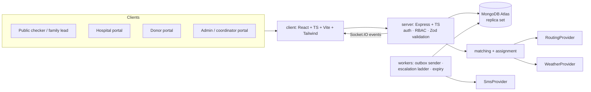
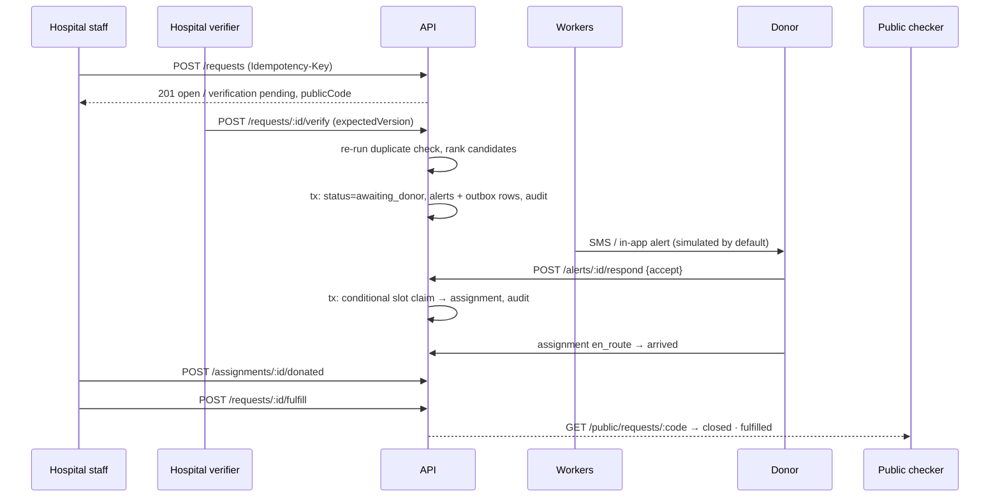

# Architecture — Golden Hour (PS-04)

**Phase:** 1 · **Status:** frozen for implementation (changes go through [decision-log.md](decision-log.md))

Related: [state-machines.md](state-machines.md) · [data-model.md](data-model.md) · [api-contracts.md](api-contracts.md) · [security.md](security.md)

## 1. Shape

A modular monolith: one React client, one Express API, one MongoDB (Atlas replica set), and in-process background workers. External services sit behind adapters with a simulated implementation that is the default.



REST is authoritative. Socket.IO only signals "something changed"; clients refetch.

## 2. Repository layout (npm workspaces)

```
/
├─ package.json            workspaces: shared, server, client
├─ shared/                 @golden-hour/shared — enums, Zod schemas, DTO types used by both sides
│  └─ src/{enums,schemas,dto}/
├─ server/
│  ├─ src/
│  │  ├─ server.ts         process entry: config → db → http + socket → workers
│  │  ├─ app.ts            Express app factory (testable without listening)
│  │  ├─ config/env.ts     Zod-validated environment; fails fast
│  │  ├─ lib/              errors, http envelope, logger, db/transactions, ids, crypto
│  │  ├─ middleware/       requestId, auth, requireRole, rateLimit, validate, errorHandler
│  │  ├─ modules/
│  │  │  ├─ auth/  users/  hospitals/  donors/
│  │  │  ├─ requests/      create · verify · duplicate review · transitions · public checker
│  │  │  ├─ matching/      filters · ranking · alert batches
│  │  │  ├─ assignments/   atomic claim · lifecycle
│  │  │  ├─ escalation/    ladder evaluation
│  │  │  ├─ notifications/ outbox · templates · webhooks
│  │  │  ├─ geo/           road reports · ETA endpoint · access points
│  │  │  ├─ leads/  transport/  transfers/
│  │  │  ├─ audit/
│  │  │  └─ dev/           demo reset + simulated SMS inbox (never mounted in production)
│  │  ├─ providers/        routing/, weather/, sms/ — interface + simulated + real impls
│  │  ├─ realtime/         Socket.IO auth + room policy + emit helpers
│  │  ├─ workers/          outboxWorker, escalationWorker, expiryWorker
│  │  ├─ types/            Express type augmentation (res.locals.user, requestId)
│  │  └─ scripts/          operator commands: createAdmin.ts, ensureIndexes.ts (+ cli.ts helpers)
│  └─ test/                unit/, integration/, concurrency/ (Vitest + Supertest + mongodb-memory-server replset)
├─ client/
│  └─ src/
│     ├─ main.tsx          React entry
│     ├─ index.css         Tailwind + design tokens + component classes
│     ├─ app/              router, query client, route guards, NotFoundPage
│     ├─ features/<area>/  one folder per area: home, public-checker, auth, hospital, donor,
│     │                    coordinator, admin, maps, notifications
│     ├─ components/
│     │  ├─ layout/        AppLayout, header/footer pieces (ApiStatus, OfflineBanner)
│     │  └─ ui/            reusable primitives + Loading/Empty/Error/Unauthorized states, ComingSoon
│     └─ lib/
│        ├─ api/           fetch client (envelope + error normalisation)
│        ├─ hooks/         generic hooks (useOnlineStatus, …)
│        └─ realtime/      Socket.IO client (Phase 9)
└─ docs/
```

### Folder rules

These keep the structure predictable as phases add code:

| Where | Rule |
| --- | --- |
| `shared/src/` | Only things both sides need: enums, API types, Zod request schemas. No Node or browser APIs. |
| `server/src/modules/<feature>/` | One folder per business feature. Files are named `<feature>.<role>.ts`: `.model.ts` (Mongoose schema), `.service.ts` (business rules, transactions), `.routes.ts` (HTTP wiring: auth, validation, response only), `.dto.ts` (allow-listed serializers), `.policy.ts` (permission checks) when needed. |
| `server/src/middleware/` | Cross-cutting Express middleware only (auth, rate limit, validation, errors). |
| `server/src/lib/` | Framework-level helpers with no business rules (db, errors, http, logger, crypto). |
| `server/src/providers/<kind>/` | `<kind>.provider.ts` interface + one file per implementation (`simulated.ts`, `openMeteo.ts`, …). |
| `server/src/scripts/` | Operator CLI commands run with `npm run <script> -w server` (e.g. `create-admin`). |
| `client/src/features/<area>/` | Pages (`*Page.tsx`), area-only components, and the area's API hooks (`api.ts`). An area never imports another area's internals; move shared pieces to `components/` or `lib/`. |
| `client/src/features/requests/` | The one cross-role feature: request detail page, its panels and hooks, used by both the hospital and admin areas (`basePath` prop). What each role may do comes from the server's `allowedActions`. |
| `client/src/features/roads/` | Cross-role feature: map page, road reports and access points, used by hospital, coordinator and admin areas. Lazy-loaded so Leaflet is a separate chunk. |
| `client/src/features/transport/` | Cross-role feature: transport task card, request-detail panel, coordinator page. |
| Cross-role features | `requests`, `roads`, `transport` may be used by any area and by each other; role areas (`hospital`, `donor`, `coordinator`, `admin`, `family-lead`) never import each other. |
| `client/src/components/map/` | Area-agnostic map primitives (`MapView`). |
| `client/src/lib/labels.ts` | Human labels and badge tones for status values, shared by all areas. |
| `client/src/components/` | Reusable, area-agnostic UI only. |
| Naming | React components `PascalCase.tsx`; everything else `camelCase.ts`; folders `kebab-case`. |

Route handlers never set status fields directly; they call a service which goes through the transition table.

## 3. Core flow (thin vertical slice)



## 4. Transactions and atomicity

Atlas (dev/demo) and `mongodb-memory-server` in replica-set mode (tests) both support multi-document transactions. All critical mutations run inside `withTransaction()` (helper in `lib/db`) and write, in the same transaction:

1. the business document change (conditional on expected state/version),
2. the `auditLogs` record,
3. any `notificationOutbox` rows.

If any step fails, nothing is committed and the client gets an error — an action is never acknowledged without its audit record. Invariants that can be expressed as unique/partial indexes are *also* enforced by index, so correctness does not depend on application-level "find then insert".

## 5. Provider adapters

All live in `server/src/providers/`, selected by environment variable, default `simulated`.

```ts
interface RoutingProvider {
  getEta(from: LatLng, to: LatLng, opts: { timeoutMs: number }): Promise<EtaResult>;
}
type EtaResult =
  | { status: 'ok'; minutes: number; distanceKm: number; source: string;
      calculatedAt: Date; quality: 'live' | 'cached' | 'simulated' }
  | { status: 'rough_estimate'; minutes: number; distanceKm: number; source: 'straight_line';
      calculatedAt: Date; quality: 'rough_estimate' }        // never shown as road ETA
  | { status: 'unavailable'; reason: string; calculatedAt: Date };  // → manualReviewRequired

interface WeatherProvider {
  getConditions(at: LatLng, opts: { timeoutMs: number }): Promise<WeatherResult>;
}
type WeatherResult =
  | { status: 'ok'; rainMmPerHour: number; source: string; observedAt: Date;
      quality: 'live' | 'cached' | 'simulated' }
  | { status: 'unavailable'; reason: string };

interface SmsProvider {
  send(msg: { to: string; body: string; idempotencyKey: string }): Promise<SmsSendResult>;
  verifyWebhook(req: RawRequest): boolean;
}
type SmsSendResult =
  | { status: 'accepted'; providerMessageId: string }      // accepted ≠ delivered
  | { status: 'failed'; errorCode: string; permanent: boolean };
```

| Provider | `simulated` implementation | Real option (optional, later) |
| --- | --- | --- |
| Routing | Deterministic: haversine × hill winding factor (default 1.8) ÷ configured hill speed (default 25 km/h), plus applied road reports. Labelled **simulated**. | OpenRouteService (key) |
| Weather | Deterministic fixture per demo scenario. Labelled **simulated**. | Open-Meteo (keyless) |
| SMS | Writes to a dev inbox collection visible on an admin "Simulated SMS" screen. Never contacts a phone. | Provider adapter behind explicit opt-in |

Every provider call has a timeout (default 4 s) and results are cached (`routeCache`, TTL configurable). Cached results keep their original `calculatedAt`, so the UI can show their age.

## 6. ETA and weather adjustment

`effectiveMinutes = baseMinutes × (1 + rainBand.pct)` where rain bands are configurable:

| Band | Rain (mm/h) | Default delay |
| --- | --- | --- |
| none | < 2.5 | 0 % |
| moderate | 2.5 – 7.6 | +15 % |
| heavy | > 7.6 | +35 % |

If weather is unavailable, the base ETA is used and the result carries `weatherAdjustment: 'unavailable'`. Weather is taken at the destination (the facility).

**Road reports (implemented Phase 7, `modules/geo/eta.service.ts`):** a report within `ROAD_REPORT_CORRIDOR_KM` (default 2 km) of the straight line between donor and facility is considered "near the route". A near report makes the ETA `unavailable` (source `road_report`) only if it is **blocked**, current (not stale), not dismissed, and **verified or high-confidence**. Every other near report (unverified low/medium blocked, any restricted) adds a warning but leaves the ETA. Stale reports are ignored. The corridor is a straight-line approximation, not the actual road geometry.

**Live routing (OpenRouteService):** results are cached in `routeCache` (key on a ~110 m grid, TTL `ROUTE_CACHE_TTL_MIN`) with their original `calculatedAt`, so a cached ETA shows its true age (`quality: cached`). If the provider fails, a straight-line `rough_estimate` is returned and labelled as such — never as a road ETA.

## 7. Realtime (Socket.IO)

- Handshake authenticates with the same session cookie as REST (`server/src/realtime/socket.ts`); anonymous sockets are refused.
- Rooms are assigned by the **server** on connect: `user:<userId>`, `role:<role>`, `facility:<facilityId>` (hospital staff). Clients cannot join rooms.
- One event, `change { topic, id?, at }`, published **after** the transaction commits (`realtime/emitter.ts`). Clients invalidate the matching TanStack queries and refetch through REST (`client/src/lib/realtime/RealtimeProvider.tsx`).
- On reconnect the client refetches everything. Polling (15–60 s) stays as the fallback, so a broken socket only makes updates slower, never wrong. The footer shows whether live updates are on or interrupted.
- Limitation: single process; several API instances would need the Socket.IO Redis adapter.

**Outbox (implemented Phase 9):** `enqueueNotification()` upserts on the unique `eventId` inside the business transaction (alert batch → `donor_alert` SMS per donor; request cancelled/fulfilled → `request_closed_for_donor` to donors still assigned). `workers/outboxWorker.ts` claims due messages with a 30 s lease (expired leases are reclaimed; the provider dedupes on `eventId`), re-checks the phone number, account status and contact consent at send time, and records `sent` (provider accepted), `failed` (permanent error, missing number/consent, or `OUTBOX_MAX_ATTEMPTS` reached) or re-queues with capped exponential backoff (5 s → 5 min, ±25 % jitter). `delivered` is only ever set from a provider receipt — the simulated provider never claims it.

## 8. Workers

Run in the API process on intervals (simple, documented limitation: they stop if the host sleeps). Each tick is idempotent and safe to run concurrently on restart.

| Worker | Interval | Job |
| --- | --- | --- |
| `outboxWorker` | 3 s | Claim due `notificationOutbox` rows with a lease (`lockedUntil`), send via `SmsProvider`, record attempt; retry transient failures with capped exponential backoff + jitter (max 5 attempts); mark permanent failures `failed`. |
| `escalationWorker` | 15 s | For verified, open requests, run due ladder steps (see state-machines.md §5). Each step is a unique `escalationEvents` row — re-running is a no-op. |
| `expiryWorker` | 60 s | Close requests past their deadline (ending alerts/assignments, SMS to donors still assigned); expire unanswered alerts and pending family leads; redact old family-lead contact data. Stale road reports need no job (`isStale` is derived). Overdue verifications are surfaced on the admin overview instead of auto-closed. |

## 9. Configuration (environment variables)

Validated with Zod at startup in `server/src/config/env.ts`. Server refuses to start if a required value is missing. Exact names:

| Variable | Required | Default | Purpose |
| --- | --- | --- | --- |
| `NODE_ENV` | no | `development` | `development` \| `test` \| `production` |
| `PORT` | no | `4000` | API port |
| `MONGODB_URI` | yes | — | Atlas connection string (secret) |
| `SESSION_SECRET` | yes | — | ≥ 32 chars; signs session JWT (secret) |
| `PATIENT_REF_SECRET` | yes | — | ≥ 32 chars; HMAC key for patient reference hashes (secret) |
| `SESSION_TTL_HOURS` | no | `8` | Session lifetime |
| `CLIENT_ORIGIN` | no | `http://localhost:5173` | Allowed CORS origin(s), comma-separated |
| `TRUST_PROXY` | no | `false` | Set `true` behind a reverse proxy / load balancer (production logs a warning if it is false) |
| `CLIENT_DIST_DIR` | no | — | Folder of the built web app (`../client/dist`); the API then serves it with an SPA fallback, one origin |
| `DEMO_MODE` | no | `false` | Enables `/api/dev/*`; forbidden when `NODE_ENV=production` |
| `ROUTING_PROVIDER` | no | `simulated` | `simulated` \| `openrouteservice` |
| `ORS_API_KEY` | if ORS | — | Routing key (secret) |
| `WEATHER_PROVIDER` | no | `simulated` | `simulated` \| `open-meteo` |
| `SMS_PROVIDER` | no | `simulated` | `simulated` or `twilio`. Twilio needs `TWILIO_ACCOUNT_SID`, `TWILIO_AUTH_TOKEN`, `TWILIO_FROM` (E.164); startup fails without them |
| `PUBLIC_APP_URL` | no | `http://localhost:5173` | Base URL used for links inside SMS |
| `SIMULATED_SMS_FAILURE_RATE` | no | `0` | Share (0–1) of simulated sends that fail transiently, to demonstrate retries |
| `PLANNED_ESCALATION_FACTOR` | no | `3` | Multiplier (1–10) on escalation step times for planned (standard-urgency) requests |
| `HOSPITAL_STRIKE_LIMIT` | no | `3` | False-request strikes after which a verified facility is suspended automatically |
| `NO_SHOW_GRACE_MIN` | no | `30` | Minutes past a donor's own ETA before an accepted/en-route donor is auto-released as `no_show` and the next donors are alerted |
| `TWILIO_WEBHOOK_BASE_URL` | no | `PUBLIC_APP_URL` | Public base URL used to verify Twilio's webhook signature (set when a proxy changes the host) |
| `INBOUND_SMS_SECRET` | no | unset | ≥32 chars. Shared secret an SMS provider sends as `x-sms-secret` to `POST /api/sms/inbound`. Unset = that webhook answers 404 |
| `OUTBOX_MAX_ATTEMPTS` | no | `5` | After this many failed attempts a message is marked failed |
| `OUTBOX_POLL_MS` | no | `3000` | Outbox worker interval |
| `PROVIDER_TIMEOUT_MS` | no | `4000` | Per external call |
| `ROUTE_CACHE_TTL_MIN` | no | `30` | Route cache lifetime |
| `WEATHER_CACHE_TTL_MIN` | no | `15` | Weather cache lifetime (per ~10 km cell) |
| `RAIN_DELAY_MODERATE_PCT` | no | `15` | Added to ETA for 2.5–7.6 mm/h |
| `RAIN_DELAY_HEAVY_PCT` | no | `35` | Added to ETA for > 7.6 mm/h |
| `SIMULATED_RAIN_MM_PER_HOUR` | no | `0` | Rain used by the simulated weather provider (demo scenarios) |
| `ROAD_REPORT_CORRIDOR_KM` | no | `2` | Distance from the straight donor→facility line within which a road report counts as "near the route" |
| `ESCALATION_STEPS_MIN` | no | `0,5,10,15` | Ladder offsets from verification |
| `ALERT_BATCH_SIZE` | no | `3` | Donors per alert batch |
| `ALERT_RESPONSE_WINDOW_MIN` | no | `5` | Alert expires if unanswered |
| `DONATION_REST_DAYS` | no | `90` | Minimum days since last donation |
| `CONTACT_COOLDOWN_HOURS` | no | `24` | Skip donors alerted more recently than this |
| `VERIFICATION_DEADLINE_MIN` | no | `30` | Unverified request is flagged overdue to admin |
| `REQUIRE_SEPARATE_VERIFIER` | no | `true` | Creator may not verify their own request |
| `LOG_LEVEL` | no | `info` | Logger level |

Client: `VITE_API_BASE_URL` (public, no secrets; default `/api` via Vite dev proxy).

## 10. Known limitations (by design)

- Workers are in-process; on hosts that sleep, escalation and SMS stop until the process wakes. Recovery on wake is idempotent.
- No real SMS, routing or weather integration is claimed as verified in the MVP; all simulated results are labelled in the UI.
- Not a dispatch service; no ambulance/108 integration; no clinical eligibility decisions.
- Zero-signal operation is impossible; SMS needs cellular coverage.
