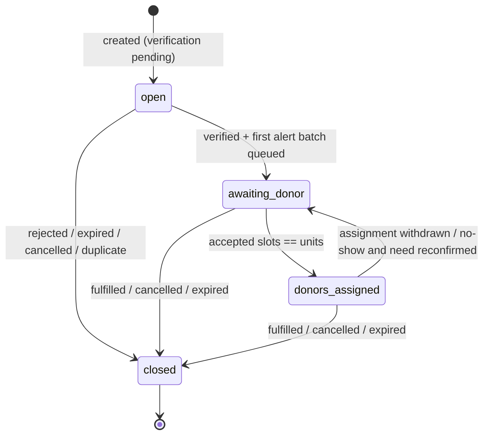
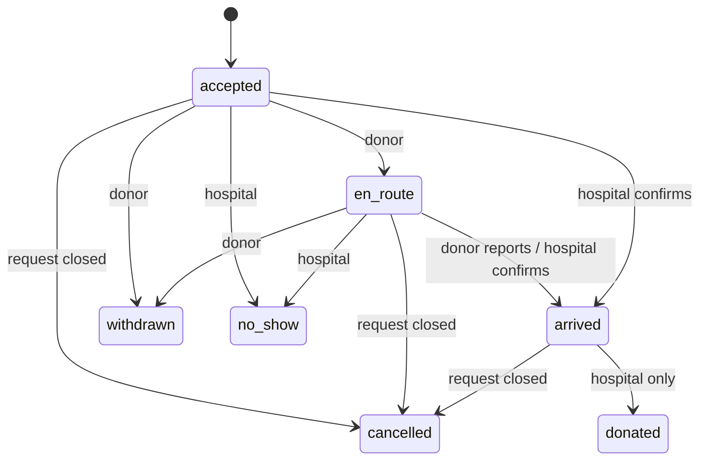

# State Machines — Golden Hour (PS-04)

**Phase:** 1 · Enums below are the exact strings used in code (`shared/src/enums`).

The following facts are **independent** and are never collapsed into one field (blueprint A3):

| Fact | Where | Field |
| --- | --- | --- |
| Institution is authorized | `hospitals` | `verificationStatus` |
| This request is real | `bloodRequests` | `verificationStatus` |
| Request progress | `bloodRequests` | `requestStatus` |
| Possible duplicate | `bloodRequests` | `duplicateReview.status` |
| Alert reached the donor | `requestAlerts` | `deliveryStatus` |
| Donor's answer | `requestAlerts` | `response` |
| Donor committed and progress | `assignments` | `status` |
| Need was met | `bloodRequests` | `closure.reason = fulfilled` (hospital only) |

## 1. Hospital (facility) verification

`pending → verified → suspended → verified`, `pending → rejected`

| From | To | Actor | Rule |
| --- | --- | --- | --- |
| `pending` | `verified` | admin | reason required |
| `pending` | `rejected` | admin | reason required |
| `verified` | `suspended` | admin | reason required; staff of a suspended facility cannot create or verify requests; open requests stay visible and are flagged to admin |
| `suspended` | `verified` | admin | reason required |

## 2. Blood request

### 2.1 Verification status

| From | To | Actor | Rule |
| --- | --- | --- | --- |
| `pending` | `verified` | hospital verifier of the **same facility** | facility verified; duplicate review not `pending`; if `REQUIRE_SEPARATE_VERIFIER`, verifier ≠ creator; `urgencyConfirmed` must be set |
| `pending` | `rejected` | hospital verifier / admin | reason required → request closes with `closure.reason = rejected` |
| `pending` | `expired` | system (`expiryWorker`) | deadline passed while unverified → closes with `closure.reason = expired` |

### 2.2 Request status

| Status | Meaning |
| --- | --- |
| `open` | Created. Not verified yet, **no alerts may exist**. |
| `awaiting_donor` | Verified; alert batches running; fewer accepted donors than units requested. |
| `donors_assigned` | Every slot has an active assignment. Escalation pauses. |
| `closed` | Terminal. `closure.reason` ∈ `fulfilled`, `cancelled`, `rejected`, `expired`, `duplicate`; `closure.by`, `closure.at`, `closure.note` required. |

Transition table (owned by `requests/transitions.ts`; anything not listed returns `409 INVALID_TRANSITION`):

| Action | From | To | Actor | Side effects (same transaction) |
| --- | --- | --- | --- | --- |
| create | — | `open` | hospital staff of verified facility | audit `request.created`; duplicate checks |
| verify | `open` (verification `pending`) | `awaiting_donor` | hospital verifier | re-run duplicate check; rank candidates; create first alert batch + outbox rows; escalation step 0 event; audit |
| reject | `open` | `closed/rejected` | hospital verifier / admin | audit |
| accept (slot claim) | `awaiting_donor` | `awaiting_donor` or `donors_assigned` | donor | assignment created; `slotsFilled += 1`; audit |
| release slot | `awaiting_donor` / `donors_assigned` | `awaiting_donor` | donor withdraw / hospital no-show | `slotsFilled -= 1`; next batch queued only if the hospital confirms `needStillExists` (donor withdrawal counts as yes); otherwise no alerts and the hospital is prompted to fulfil or cancel; audit |
| fulfill | `awaiting_donor` / `donors_assigned` | `closed/fulfilled` | hospital staff (same facility) | requires `unitsReceived ≥ 1`; cancel pending alerts; audit; outbox to assigned donors |
| cancel | `open` / `awaiting_donor` / `donors_assigned` | `closed/cancelled` | hospital staff / admin | reason required; cancel alerts + active assignments; audit; outbox to assigned donors |
| expire | any non-closed | `closed/expired` | system | deadline passed; same cleanup as cancel |
| mark duplicate | `open` | `closed/duplicate` | hospital verifier / admin | `duplicateOfRequestId` required |

Every transition uses a conditional update `{ _id, requestStatus: <from>, version: <expectedVersion> }` and `$inc: { version: 1 }`. Zero matched documents → `409 CONFLICT` with the current state. Reopening a closed request is not supported; a recurring need is a new request.

The request **timeline** shown in the UI is derived from audit events (`created`, `verified`, `alerted`, `accepted`, `en_route`, `arrived`, `donated`, `fulfilled`/`closed`), not stored on the request document.

## 3. Duplicate review

| Status | Meaning |
| --- | --- |
| `none` | No signal. |
| `pending` | Similarity check flagged a possible duplicate. **Verification is blocked** until resolved. |
| `distinct` | Verifier confirmed it is a separate need (reason required). |
| `duplicate` | Verifier confirmed duplicate → request closes with `closure.reason = duplicate`. |

## 4. Donor alert

Two independent fields:

**`deliveryStatus`** — what the channel reported: `queued → sent → delivered`, or `queued → failed`, or `sent → unknown` (no receipt). `sent` means the provider accepted it, not that a person read it. In-app alerts are `delivered` when written.

**`response`**:

| From | To | Actor | Rule |
| --- | --- | --- | --- |
| `pending` | `accepted` | donor (owner of alert) | request `awaiting_donor`; slot available; donor has no other active assignment; alert not expired |
| `pending` | `declined` | donor | — |
| `pending` | `expired` | system | `ALERT_RESPONSE_WINDOW_MIN` passed |
| `pending` | `cancelled` | system | request closed or all slots filled |

A repeated identical response returns the original result (idempotent). Accepting after the slots filled returns `409 SLOTS_FILLED` and sets `response = cancelled`.

## 5. Escalation ladder

Offsets from verification time, configured by `ESCALATION_STEPS_MIN` (default `0,5,10,15`):

| Step | Default | Condition to run | Action |
| --- | --- | --- | --- |
| 0 | 0 min | on verify | Alert top `ALERT_BATCH_SIZE` ranked donors. |
| 1 | 5 min | request still `awaiting_donor` | Widen: next batch, including donors ranked beyond the deadline window (flagged "may be late"). |
| 2 | 10 min | still `awaiting_donor` | Notify admins; advise hospital (in-app banner + outbox) to use its own blood bank / stock transfer. |
| 3 | 15 min | still `awaiting_donor` | Create an admin task to contact nearby hospitals/blood banks; suggest stock-transfer request. |

Each step inserts `escalationEvents { requestId, step }` (unique index). If the insert hits the unique key, the step already ran → no-op. Each event records `outcome` (`executed`, `skipped_condition_not_met`, `failed`) and `at`.

**Implemented (Phase 10):** step 0 is recorded in the verify transaction (outcome `executed` if donors were alerted, otherwise `skipped_condition_not_met`). `workers/escalationWorker.ts` runs steps 1+ every 15 s for verified requests still `awaiting_donor`. Step 1's outcome reflects what really happened: `executed` only if it alerted at least one donor, `skipped_condition_not_met` if no eligible donor remained, `failed` if the alert batch errored. Steps 2 and 3 are audited (`request.escalated_level_2/3`), shown as banners to the hospital and appear in **Admin → Escalations**; there is no automatic outside contact. A request flagged **under review** is skipped by the worker (paused, not escalated), and a request that is no longer `awaiting_donor` (donor accepted, closed) is never escalated.

### 5.1 Administrator review flag

An administrator can place any non-closed request **under review** (e.g. after suspicious-request reports) and clear it, each with a reason (`request.flagged_under_review`, `request.review_cleared`). While flagged: the public checker shows `under_review`, the request cannot be verified, new donor alerts (manual and escalation) are refused, and escalation pauses. Cancel, reject and fulfil stay possible; donors already assigned are not cancelled.

### 5.2 Expiry (`workers/expiryWorker.ts`, every 60 s)

| What | Rule |
| --- | --- |
| Request past `deadlineAt`, not closed | Closes with `closure.reason = expired`, ends pending alerts and active assignments, SMS "no longer needed" to donors still assigned, audit `request.expired`. An unverified request also gets `verificationStatus = expired`. |
| Pending alert past `expiresAt` | `response = expired` (reads already treat it as expired). |
| Pending family lead past 24 h | `status = expired`. |
| Decided/expired family lead older than 30 days | Name, phone and note replaced with `[REDACTED]` (data retention). |
| Road reports | Never deleted: `isStale` is computed from `expiresAt`, and stale reports never affect ETAs. |

## 6. Assignment

| Status | Active? | Notes |
| --- | --- | --- |
| `accepted`, `en_route`, `arrived` | yes | Occupies a slot. A donor can have at most **one** active assignment overall. |
| `donated` | no | Hospital confirmed this donor donated. Updates donor `lastDonationAt`. Keeps its slot (the unit was given) but frees the donor. Does **not** fulfil the request. |
| `withdrawn`, `no_show`, `cancelled` | no | Frees the slot. `no_show` requires a reason and records a strike (see security.md §6). |

`arrivedBy` records whether arrival was `donor_reported` or `hospital_confirmed`.

## 7. Family lead

`pending → confirmed` (hospital creates a linked request; only then can matching begin), `pending → rejected` (reason), `pending → expired` (24 h). A lead never creates alerts itself.

## 8. Road report

`verificationStatus`: `unverified → verified | dismissed` (coordinator/admin). Separately, a report is **stale** when `now > expiresAt`; stale reports are shown greyed and never affect ETA.

## 9. Transport task

`requested → assigned → picked_up → handed_over → completed`, or `→ failed | cancelled` (reason). `completed` requires the receiving party's confirmation. Transport state never changes request or assignment state.

| Action | From | To | Actor |
| --- | --- | --- | --- |
| claim | requested | assigned | any coordinator (becomes assignee) |
| picked_up | assigned | picked_up | assignee |
| handed_over | picked_up | handed_over | assignee |
| complete | handed_over | completed | hospital staff of the facility (receipt) |
| fail | assigned, picked_up, handed_over | failed | assignee, facility staff, admin — note required |
| cancel | requested, assigned | cancelled | facility staff, admin — note required |

## 10. Stock transfer request

`requested → offered → dispatched → received`, or `→ declined | cancelled`. Only the requesting facility can mark `received`. Independent of blood-request closure — the hospital still confirms fulfillment separately.

| Action | From | To | Side |
| --- | --- | --- | --- |
| offer (offeredUnits ≤ units) | requested | offered | responding |
| decline (note) | requested | declined | responding |
| dispatch | offered | dispatched | responding |
| receive | dispatched | received | requesting |
| cancel (note) | requested, offered | cancelled | requesting |
